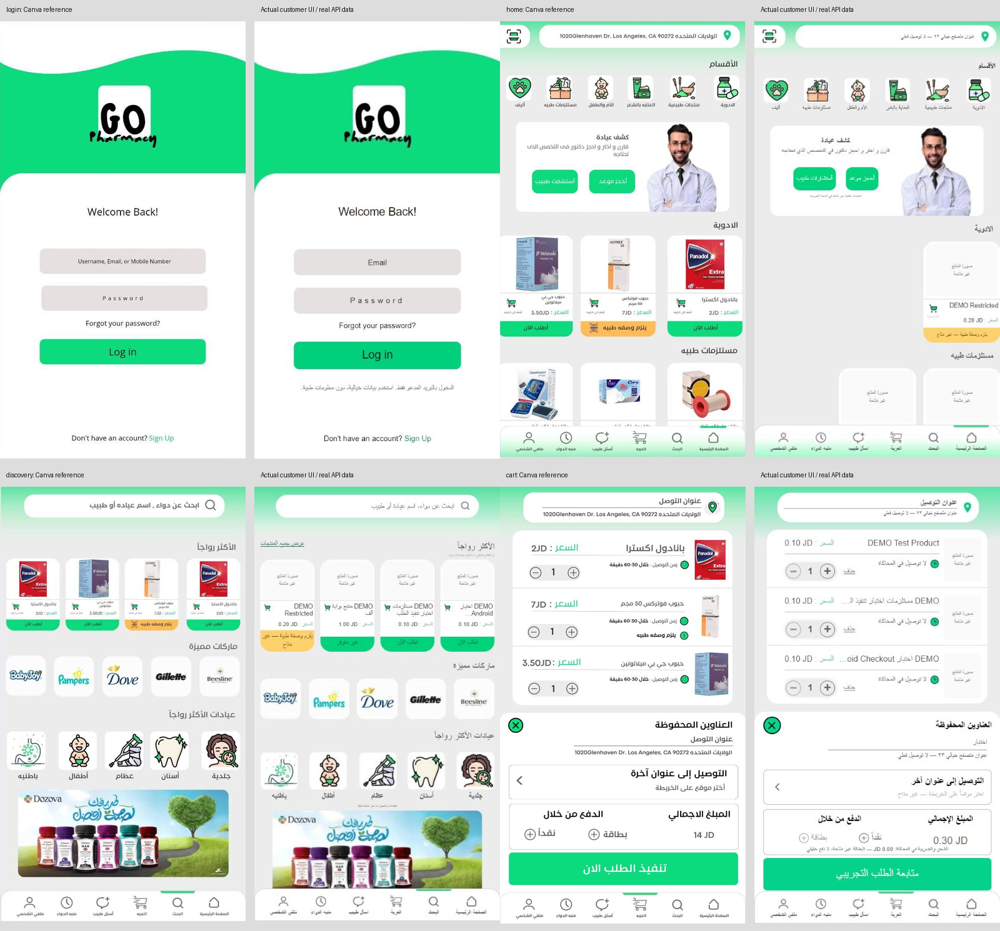

# GO Pharmacy — customer Canva restoration V1

Source: clean latest local commit `6e3d11877b18a13656d7638c2ce0aeef12d8438b`, verified against all local branches and history on 2026-10-29. This includes Multi-App, tenancy, Partners, fulfillment, Capacitor and Checkout E2E. Working branch: `feat/customer-canva-ui-restoration-v1`. No main, merge, push or publication.

## Authoritative references and asset provenance

All four newly supplied JPGs were inspected. Originals are retained in `docs/design/canva/`.

| Supplied image | Customer screen | App-only crop in original pixels |
| --- | --- | --- |
| 1000073027.jpg | Login | (24,163)–(552,1104), 528×941; excludes Canva toolbar, system status and editor footer |
| 1000073024.jpg | Discovery | (0,0)–(724,1280), 724×1280 |
| 1000073025.jpg | Main home | (5,3)–(723,1277), 718×1274; excludes outside edge |
| 1000073026.jpg | Cart/checkout design | (0,0)–(720,1280), 720×1280 |

`scripts/extract-canva-assets.py` makes deterministic crops, not generated replacements. `docs/design/canva/asset-manifest.json` records every source rectangle. 31 raster elements are bundled locally: original login header/logo, doctor, Dozova banner, six category tiles, five clinic tiles, five brand marks, three medicine images, six bottom icons, pin and scan icon. No stock service or image generation was used. Assets work offline inside Capacitor.

**Missing originals:** editable Canva export/source document, original font files and exact font family/weights, separate vector GO logo, original icon vectors, original full-resolution doctor/advert/product photos. The JPGs contain only rasterized versions. The bottom of the home reference is obscured by its navigation, so off-screen product labels and further page content are unspecified. There is no separate original checkout-contact form, registration, product-detail, tracking, profile or unavailable-service screen specification.

The existing catalog has five active fictional DEMO records and no image URLs. None is an exact identity match for Panadol, Votrex or JP Melatonin. We therefore **do not attach those medicine images to fictional unrelated products**, duplicate catalog rows, fabricate prices or overwrite the database to match the screenshot. This is a material visual difference, not a missing frontend API connection.

## Implemented customer surfaces

- Customer-only shell/gray background, gradient address/search headers, original six-item RTL navigation: home, search, cart, ask doctor, medication reminder, profile. Fixed bar is outside the size-contained content so it stays in the viewport. Safe-area handling is retained.
- `/login`: exact cropped wave/logo header, measured control positions, gray fields, green Log in, forgot and signup positions. Real invited-email authentication/registration is preserved. Partners/Admin login keeps its legacy layout. Recovery explains that it is unavailable; it does not pretend to send email.
- `/`: original category ordering, clinic banner/doctor and button positions, three-column product sections. Product rows use actual category/API records only. A missing category/product does not become a fictitious record.
- `/products`: original search/popular row, five brands, five clinics, original banner. Explicit full-catalog action plus original category and price/name sorting retained. Brand controls search real manufacturer/name/description data; clinics explain unavailability. A note discloses that real popularity statistics do not exist.
- `/cart`: rounded original row/sheet layout, real quantity mutations and totals, saved owned addresses, payment/map positions. No fabricated ETA, screenshot Los Angeles address, screenshot prices or hardcoded14JD total. Card/map are unavailable and cash is simulation-only.
- The compact cart sheet shows the first owned address, matching the design's single-address layout, with a link to all existing addresses when more exist. No address is deleted; Profile management and the full Checkout address selector remain available.
- `/checkout`: same design language around real contact/address/acknowledgment fields. The contract, canonical phone handling, UUID, saved-request restoration and safe retry payload remain intact. A new payload cannot consume another account's cached quote. Entire foreign/error quotes and address options are hidden.
- Product detail now uses real/matching artwork or explicit missing-image state. Its former unsupported free-shipping claim is replaced by the truthful simulation status. Other unspecified customer routes retain their working content and inherit only the customer shell.

## Security and compatibility

Runtime backend, database schema/migrations, authentication/session service, prices/transactions/reservations, shared checkout contract, native HTTP transport, origin/proxy policy, Capacitor config and dependencies are unchanged. Partners source, Admin pages and their existing layout are unchanged. The root router chooses the customer layout only for customer routes.

Fresh read-only review identified stale cross-account address/quote display, hidden full catalog and undersized phone text. Frontend owner/error gates, explicit catalog browsing and minimum fonts address these. Ownership is server-enforced as before; UI gates additionally avoid displaying cached private records during account changes/refetch errors. Saved ambiguous checkout retries retain the original request and key.

No medical, prescription, payment, dispensing or delivery workflow was enabled. The phone's existing HTTPS service/tunnel was not started, restarted, replaced or reconfigured. Only private loopback test runtimes are used.

## Visual fidelity and remaining differences

This is **not an assertion of pixel-perfect identity**. Side-by-side comparison must be read with these differences:

1. Missing original font files: Arial/Tahoma/system Arabic fallback has visibly different glyphs and weights, especially on Windows versus Android.
2. Raster extracts have JPG artifacts/resolution limits. The login hero is the original crop, not a newly traced vector. Full-resolution originals are needed to remove these differences.
3. Real API product counts/names/prices/images/addresses differ from Canva's sample content. Missing product imagery is labelled; home medicine section currently contains one restricted DEMO item, not three screenshot medicines.
4. Invite-only/simulation/unavailable notices, accessible minimum text/control sizes, delete/full-catalog actions and required checkout contact/ack fields add necessary visible differences. At small phone widths, text floors grow relative to a literal downscale of the reference.
5. The screenshot combines cart/payment presentation; secure checkout remains a separate route with extra required fields. No separate authoritative specification for that route was supplied.
6. Dozova artwork is explicitly reference artwork, not a sales offer or product-availability assertion.
7. The existing Android HTTPS connection toolbar remains visible above the customer app. Its only code change is a data attribute used by scoped login height CSS; the signup control is verified visible with that toolbar and safe areas. The toolbar is not Canva editor chrome and is retained intentionally.

## Verification ledger

Baseline: 168 tests/31 files passed on the guarded dedicated MySQL database; all28 tables restored and verified afterward. No migration. A separate private snapshot protects the state before final reset-based testing. Public evidence contains hashes/counts only; backups/credentials/certificate keys remain ignored under `.local`.

Final automated, browser, Android and preservation results are recorded in `docs/evidence/canva/verification.json` and the adjacent logs. The first Android build command attempted both instrumentation build types in one invocation; Gradle correctly rejected the absent Debug test task when checkoutTest was selected. Separate invocations are used; no version or protection change was needed.

| Executed final verification | Result |
| --- | --- |
| Full Vitest with guarded MySQL test DB | 173 passed,0 failed,0 skipped;32 files,88.50s |
| Application/test TypeScript | Both exit0 |
| Production build | Exit0; existing large-chunk advisory remains |
| Capacitor sync / ordinary Debug / isolated test build | Passed; final Gradle40s and46s |
| Full Android API36/WebView133 journey on final assets | 1 passed,53.135s; simulated order200 ready |
| Ordinary Debug package instrumentation | 2 passed,0.06s |
| Browser observations | 21 executed,0 failed; simulated order198 created |
| Responsive browser widths | 360,nominal393(actual rounded394),430: RTL, six-item fixed nav, no horizontal overflow |
| Actual APK archive comparisons | 40 files per APK,80 SHA256 matches (8JS/CSS,31PNG,index) |
| APK trust/signature | Ordinary APK has no test CA/network config; v2 signature verifies |
| Data preservation | All239 pre-task test rows retained; all18 Demo table fingerprints unchanged |

Reset-based test snapshots were restored and compared across28 tables. Normal fictional order creation subsequently changed only three existing catalog stock counters/timestamps and one pharmacy inventory quantity/version/timestamp, as expected. All original users, addresses, orders, memberships and credentials remain unchanged. New orders197,199,200 were explicitly assigned and reached ready; browser198 is retained unassigned. Each assigned new order has exactly one assignment/reservation; zero duplicate new request keys. Stock decreases match the quantities of these real simulated transactions. No migration or Demo write occurred.

APK: `android/app/build/outputs/apk/debug/app-debug.apk`,5,261,290 bytes.
SHA256: `f00914aa089f4e7e8d808fb25b6b80446bf897b3dd55c03c7b63741df6576eeb`.
The special checkoutTest package is not the delivery APK. No physical device was attached or tested.

### Screenshots and side-by-side evidence

| Screen | Browser screenshot | Canva comparison | Actual Android screenshot |
| --- | --- | --- | --- |
| Login | [image](evidence/canva/login.jpg) | [comparison](evidence/canva/compare-login.png) | [native](evidence/canva/canva-login.png) |
| Home | [image](evidence/canva/home.jpg) | [comparison](evidence/canva/compare-home.png) | [native](evidence/canva/canva-home.png) |
| Discovery | [image](evidence/canva/discovery.jpg) | [comparison](evidence/canva/compare-discovery.png) | [native](evidence/canva/canva-discovery.png) |
| Cart | [image](evidence/canva/cart.jpg) | [comparison](evidence/canva/compare-cart.png) | [native](evidence/canva/canva-cart.png) |
| Additional secure Checkout route | [image](evidence/canva/checkout.jpg) | No separate supplied reference | [native](evidence/canva/canva-checkout.png) |

All comparisons were inspected and layout errors corrected (fixed bar containment,
cart row/header heights, discovery spacing, native login signup height and home nav gradient).
The screenshots use equivalent phone aspect ratios; CSS minimum text sizes intentionally
prevent a literal unreadable downscale. `visual-comparison.json` includes descriptive
raw RGB differences, **not** an approved tolerance or a visual pass score. Native images
retain their real status/navigation/connection controls as evidence.

## Local testing

1. Open the prepared local test web runtime at `http://localhost:3022/login`. Private fictional account details remain in `.local/partners/browser-users.json`; never publish that file.
2. Login, use the six bottom destinations, search/brand/category/full-catalog controls, and inspect unavailable clinic/reminder states.
3. Add actual DEMO items, increment/decrement/remove quantities, inspect the server total, close/reopen saved addresses and follow address management.
4. Continue to Checkout, choose an owned fictional address, try invalid letters in the phone field, then Arabic/Persian digits, acknowledge simulation and submit once. Inspect the saved simulated order.
5. For complete fulfillment, follow `ANDROID_CHECKOUT_TESTING.md`: administrator explicitly enrolls/assigns, staff accepts/prepares/marks ready, original customer checks status. No historical orders are automatically enrolled.
6. Open `android/` in installed Android Studio with existing JDK21/API36. The delivered ordinary Debug APK is `android/app/build/outputs/apk/debug/app-debug.apk`. Update-install without deleting existing app data. A real phone needs its authorized trusted HTTPS backend; the emulator's private test origin is not phone hosting.

Do not run the reset-based integration suite against Demo, or against a running test database without a verified backup/restore and stopped task writers. The separately named checkoutTest package/test CA is for local emulator instrumentation only and must not be distributed as the ordinary phone app.
