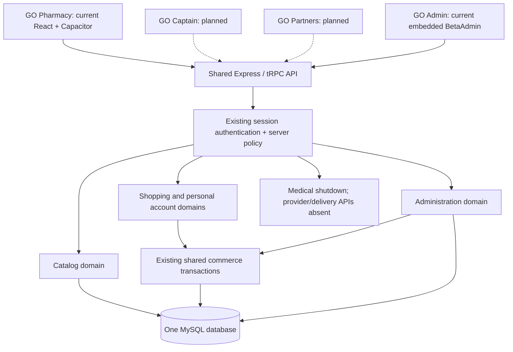

# GO Pharmacy — Multi-App Architecture Foundation V1

## Implemented architecture

One modular application backend and one central MySQL schema serve future clients.
The current React customer UI and embedded admin page remain in their existing
location. There is no monorepo conversion, second database, new infrastructure,
dependency upgrade, UI redesign or deployment.



`server/routers.ts` is now a composition root. Its existing domain routers moved
without handler/validator changes to `server/domains/catalog.ts`, `shopping.ts`,
`account.ts`, `administration.ts` and `medical.ts`. Auth stays in `server/auth.ts`;
commerce transactions stay in `server/commerce.ts` and rules in commerce-rules.ts.
Shared DB queries remain in db.ts. This is an intentional incremental seam:
existing router-level SQL is not duplicated into speculative services.

All **52 existing procedure names** remain, including unavailable legacy APIs.
`AppRouter` is still exported from the original path. The only additional endpoint
is authenticated query `platform.capabilities`, contractVersion **1**. A checked-in
legacy manifest and regression test pin the old procedure surface; extraction
evidence compares normalized TypeScript handler ASTs with the reference commit.

## Four application contracts

| Application | Shared services / current API | Availability and next boundary |
| --- | --- | --- |
| GO Pharmacy | identity (`auth.*`), catalog (`products.*` reads), personal (`cart.*`, `orders.*`, `addresses.*`, `notifications.*`) | Current web + Android. Personal data always uses session user ID; simulated checkout only. Medical services remain unavailable. |
| GO Captain | identity + delivery | Planned. No driver assignment API. Future minimal delivery DTO must omit prescriptions, patient notes and order items that reveal medical information. |
| GO Partners | identity + medical + partner_inventory | Planned. Doctor/clinic/pharmacy operations must require approved organization membership and resource relationship, not just a role. Legacy medical endpoints stay gated. |
| GO Admin | identity + administration (`admin.*`, product writes) | Embedded beta interface currently; a separate web client can reuse these guards/services. Provider approval, role administration and audit APIs are not implemented. |

`shared/applications.ts` defines the common application, service, role and
capability vocabulary. The discovery response distinguishes `available`,
`embedded_beta` and `planned` clients. Its applications array describes intended
architecture; only `services` describes the authenticated account's currently
enabled services. It is informational, never an authorization token.

Example customer discovery payload (inside the existing tRPC/SuperJSON envelope):

```json
{"contractVersion":1,"role":"customer","services":["identity","catalog","personal"]}
```

The full response also contains the four application descriptors. Existing auth
responses retain the persisted `user` spelling for compatibility. Consumers must
use `import type { AppRouter } from .../server/routers` / tRPC inferred inputs and
outputs rather than duplicate checkout or auth contracts in each client. No new
standalone SDK or copied business rules are needed for V1.

## Authentication and role boundaries

`server/access-policy.ts` maps only current database enum values:
`user → customer`, `doctor → doctor`, `pharmacist → pharmacist`, `admin → admin`.
Unknown values fail closed. `delivery_driver`, `clinic`, `super_admin` and even
the canonical `customer` spelling are **not accepted as persisted roles** in V1.
They are reserved vocabulary; adding an enum string alone will not activate them.
No user is migrated, promoted, invited or deleted by this task.

| Canonical role | Current persisted value | Own personal commerce/account | Admin/catalog management | Clinical/provider/private inventory | Driver workflow |
| --- | --- | --- | --- | --- | --- |
| customer | user | Allowed, own records | Denied | Denied | Denied |
| doctor | doctor | Allowed, own records | Denied | Denied | Denied |
| pharmacist | pharmacist | Allowed, own records | Denied | Denied | Denied |
| admin | admin | Allowed, own records | Existing beta operations | Denied | Denied |
| delivery_driver | Not activated | Denied pending identity model | Denied | Denied | Denied pending assignments |
| clinic | Not activated | Denied | Denied | Denied pending tenancy | Denied |
| super_admin | Not activated | Denied | Denied pending audited provisioning | Denied | Denied |

Catalog reads remain public exactly as before. `protectedProcedure` now requires
both authentication and a supported persisted role; adminProcedure uses the same
central policy. MedicalProcedure remains an unconditional shutdown after account
authentication, including for administrators. Existing handlers retain ownership
checks and user predicates. A doctor/pharmacist account can buy for itself; that
does not make it a medical/provider operator. No client-supplied role, application
ID, native header or capability response grants authority.

Opaque sessions are still looked up in MySQL and joined to the current user row.
Passwords, invitation HMAC, cookie protections, same-origin validation, native
HTTPS opt-in, trusted proxy configuration, rate limits, idempotency, simulation
acknowledgement and transaction locking are unchanged. No CORS/SSL bypass or
session token in localStorage was added. Captain and Partners must eventually
use the same identity service with deliberately configured application origins;
do not enable wildcard origins or copy the Android marker as authentication.

## Ownership and tenant rollout gates

- Customer cart/order/address/notification operations derive owner ID from the
  authenticated server context. Cross-user denial is tested against real MySQL.
- Drivers have no active role or API; medical APIs deny even a constructed driver
  context. Before delivery activation, create scoped assignments and a redacted
  projection, with cross-driver and medical-data exclusion integration tests.
- Pharmacies have no private inventory/order API or organization ownership schema.
  Existing global beta products are public catalog data. Do not relabel the
  global stock table as tenant inventory. Add organization + memberships and
  explicit inventory/order allocation before any pharmacy operational endpoint.
- Doctors cannot retrieve any patient information through active medical APIs.
  Before activation, require approved provider identity, care/appointment
  relationship, patient scoping in every query, and cross-provider tests. Repair
  the retained unscoped legacy lookups before removing the shutdown.
- Clinic tenancy, delegated roles and super-admin provisioning require an additive,
  reviewed migration and security audit trail. A role label alone is insufficient.

These gates give safe **current denial**, not a claim that a complete future
tenant/driver security system exists. No destructive migration or data rewrite is
needed for the implemented foundation.

## Expansion order

First define organization/membership/approval and scoped resource ownership in an
additive schema proposal, then implement one narrow pharmacy inventory workflow
with two-organization isolation tests. Keep existing global beta data unchanged
until an explicit allocation/migration plan is approved. Build a separate Partners
client only after that backend contract works. Captain should follow with minimal
delivery assignments and redacted DTOs. Separate Admin UI packaging can follow
without moving the transaction/auth implementations.

See [functional inventory](MULTI_APP_INVENTORY_V1.md) and
[verification / Android report](MULTI_APP_VERIFICATION_V1.md). The unresolved
Android checkout validation issue remains a separate acceptance item.
