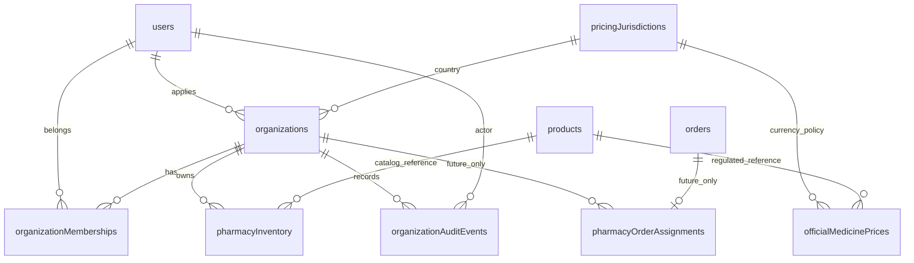

# Pharmacy Multi-Tenancy & Inventory Foundation V1

Base `b256aaf39d8a4c18398fae1d72d97a1d083b3b0c`; branch
`feat/pharmacy-tenancy-inventory-v1`. This adds operational backend contracts,
not a Partners UI, sales workflow, dispensing system or deployment.

## Data and application architecture



Migration0004 adds seven tables. Existing tables, users, customer orders and
catalog data are untouched; there is no stock/price backfill or order assignment.

| Table | Purpose and constraints |
| --- | --- |
| pricingJurisdictions | Country PK, currency code and decimal precision; JO/JOD/3 metadata only. |
| organizations | Pharmacy initially; clinic/provider type reserved. Country FK, applicant user FK; unique country/registration reference; indexed status/id and applicant. |
| organizationMemberships | Composite PK (organizationId,userId), both FKs; role and status; user/status/organization index. No implicit membership from a platform role. |
| pharmacyInventory | Composite PK (organizationId,productId), both FKs; quantity CHECK 0..1,000,000, version CHECK >=0; product lookup index. No price column. |
| organizationAuditEvents | Tenant and actor FKs, action/reason/details/timestamp; organization/id and actor indexes; unique tenant/requestId for stock idempotency. No API updates/deletes. |
| officialMedicinePrices | Independent country/product FKs; DECIMAL(12,3) amount, authority/reference, effective window, verification timestamp; country/product/start uniqueness and amount/date checks. Empty. |
| pharmacyOrderAssignments | Future-only order PK/FK, organization FK and assigning-user FK; organization/actor indexes. No API, rows or customer-order link activation. |

All new FKs use restrictive deletion. Users/products/orders referenced by tenant
data cannot be deleted accidentally. Old product archive and simulated checkout
continue to use the existing global beta stock/price. Changing pharmacy inventory
does not change checkout availability or catalog stock. Do not advertise it as
live pharmacy fulfillment until assignment/reservation workflows are implemented.
The future assignment table permits one pharmacy per order; split fulfillment and
assignment history are not implemented and need a separate contract.

## Organization and membership lifecycle

1. An authenticated supported account submits a pharmacy application. The server
   sets type=pharmacy/status=pending and creates that account's pending owner
   membership atomically, with an audit event. Input cannot choose owner or status.
2. Platform admin reviews registration out of band, then uses the governance API.
   Status transitions: pending→approved/rejected; rejected→pending;
   approved→suspended; suspended→approved/rejected. Every transition needs a reason
   and is audited. An applicant admin cannot approve its own application.
3. Organization approval **does not activate any membership**. Admin explicitly
   provisions an existing user and membership role/status. Active status requires
   an approved organization. Reactivating an organization does not unsuspend staff.
4. Owner is the applying account in V1; ownership transfer is unavailable. Other
   users cannot be set to owner, and the applying account cannot be silently demoted
   into another role. Admin can suspend its membership.

Registration reference validation is structural, not a government-license check:
3..100 ASCII letters/digits/slash/hyphen, trimmed and normalized to uppercase;
name 3..200 characters. No automatic verification, document upload, regulatory
attestation or approval notification was implemented. Clinical providers remain
inactive; extending types requires a reviewed onboarding/permission model.

## Authorization matrix

All private endpoints require a supported authenticated account, organization
type=pharmacy, status=approved, an active membership for the session user, and the
operation's membership role. A caller-supplied organization ID is only a selector.

| Actor | Own stock read | Stock adjustment | Member/audit read | Organization/member governance |
| --- | --- | --- | --- | --- |
| Active owner/manager | Yes | Yes | Yes | No, unless separately platform admin |
| Active inventory_staff | Yes | Yes | No | No |
| Active viewer | Yes | No | No | No |
| Pending/suspended member | No | No | No | No |
| Any account in pending/rejected/suspended organization | No | No | No | Platform admin only |
| Platform pharmacist/doctor with no membership | No | No | No | No |
| Platform admin with no membership | No | No | No | Explicit audited governance endpoints only |
| Anonymous | No | No | No | No |

The `mine` endpoint returns only the caller's membership and basic organization
metadata, including pending/suspended state. It does not disclose another user's
membership or private operational records. There is no public organization list.
The admin list is deliberate governance visibility, not tenant inventory access.
Trusted admin provisioning can explicitly grant memberships and is audited; this
does not implement two-person approval for every membership change.

Existing `platform.capabilities` remains a global-role discovery contract; its
partner_inventory flag is not a tenant grant. Discover memberships via
`pharmacies.mine`, then let each tenant operation authorize current DB state.
Medical shutdown, authentication/session/allowlist, native HTTPS guard, rate
limits, ownership of customer records and administrative guards remain intact.

## API procedures (additive)

All nine use existing tRPC/SuperJSON transport and strict Zod inputs. Lists are
bounded to 1..100 rows (default50), with explicit numeric cursors.

| Procedure | Type / caller | Input and behavior |
| --- | --- | --- |
| pharmacies.submitApplication | Mutation, authenticated | name, registrationNumber, countryCode="JO"; returns id/status=pending. Duplicate registration conflicts. |
| pharmacies.mine | Query, authenticated | afterId=0, limit; own memberships and organization status. |
| pharmacies.inventory.list | Query, active member | organizationId, afterProductId=0, limit; tenant quantity/version plus public product name/Rx flag. Excludes global stock/price and official-price guesses. |
| pharmacies.inventory.adjust | Mutation, owner/manager/staff | organizationId, productId, delta, expectedVersion, UUID requestId, reason. |
| pharmacies.members.list | Query, owner/manager | organizationId, afterUserId=0, limit; user ID/role/status, no email or credential data. |
| pharmacies.audit.list | Query, owner/manager | organizationId, optional beforeId, limit; newest first; excludes internal request hashes. |
| pharmacies.administration.list | Query, platform admin | optional status, afterId=0, limit; onboarding review queue. |
| pharmacies.administration.review | Mutation, platform admin | organizationId, next status, reason; transition checked and audited. |
| pharmacies.administration.setMembership | Mutation, platform admin | organizationId, existing userId, membership role/status, reason; never changes users.role. |

Stock input example (fictional inventory count, not a sale or a price):

```json
{"organizationId":101,"productId":1,"delta":5,"expectedVersion":0,"requestId":"891254fc-f27c-4b75-ae9c-b20ad96a4b6f","reason":"Fictional physical stock count"}
```

An absent inventory record means quantity0/version0. An authorized first adjustment
creates it with version1. Delta must be an integer from -100000 to100000, excluding
zero; final quantity must remain 0..1,000,000. Reasons are trimmed, 3..500 characters.
Outdated expectedVersion returns CONFLICT; refresh and explicitly re-evaluate.
Network retries use the same requestId and unchanged input. A replay is authorized
again before lookup and binds actor, product, delta, expectedVersion and reason;
changed input or another actor using the same tenant/requestId conflicts.

## Transactions, concurrency and audit

Private reads/writes and governance first lock the organization row, then validate
membership with a locking read, then access tenant data. Approval/suspension/member
changes use the same lock order. This provides current-state checks without
authorization caches and serializes revocation against stock changes. Different
pharmacies lock different rows. V1 deliberately serializes operations within one
organization; it is a simple correctness baseline, not a throughput benchmark.

Stock change and audit insertion share one MySQL transaction. A failed audit
insertion rolls back the inventory change, including creation of a first row.
The audit records before quantity, delta, after quantity/version, actor, reason
and timestamp. Governance and onboarding are also audited transactionally.
Rejected requests do not produce misleading successful-adjustment events.

Audit is append-only through these APIs, not cryptographically tamper-proof or
immutable against a privileged SQL operator. Future production provisioning must
review least-privilege DB grants and external audit retention. This task did not
change global MySQL privileges or weaken binary-log protections.

## Jordan and official prices

Only country/currency metadata is seeded. Jordan's official currency is the dinar
divided into1000 fils, hence three decimal digits in this independent future
pricing model ([Jordan Ministry of Foreign Affairs](https://www.mfa.gov.jo/ar/contents/official-currency)).
No official medicine price was invented, copied from demo product.price, hardcoded,
imported or exposed by a write API. Existing two-decimal simulation prices remain
unchanged. No claim of regulatory pricing compliance is made by the empty schema.

Future ingestion must verify authority, product/pack mapping, effective dates and
country rules, then handle overlapping/superseded records under an approved data
process. There is no pricing importer or connection to checkout in V1.

See [migration operations](PHARMACY_MIGRATION_V1.md) and
[executed verification](PHARMACY_VERIFICATION_V1.md). Android checkout validation
remains OPEN and is not fixed by this work.
